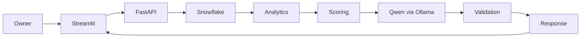

# Architecture

Snowflake does spatial filtering and full neighborhood category aggregation near the owner's coordinates, returning only aggregate rows and a bounded marker list. A verified canonical view isolates listing release changes and real geometry conversions. The full counts are independent of marker truncation. Its source provenance and query profile are part of the demo evidence.

Python analytics creates an evidence registry. Scoring uses a documented saturation heuristic independently of the model. Qwen contributes goal- and preference-sensitive strategy synthesis and practical experiments using those inputs; a generic chat prompt cannot override the evidence contract. Structured output and strict citation validation prevent substituted numeric evidence. The server builds observation reasons, while model prose is treated as fallible advice. This is a meaningful model feature; deterministic fallback is explicitly a degraded experience.

The API runs synchronous handlers in FastAPI's worker threads so blocking Snowflake/HTTP calls do not block the event loop. Each request has its own Snowflake connection and cursor, with statement/network timeouts. Ollama outputs use a locked, bounded, process-local cache keyed by model, full owner context, scores, and evidence. Concurrent identical cold requests may both generate; no distributed cache or request queue is implemented. For this demo, run a single API worker and avoid bursts of parallel model calls.

Configuration loads once at process startup from environment/.env. Health reports configuration without contacting dependencies; use a real analyze request for end-to-end readiness. SQL values are bound parameters, only configured simple identifiers enter SQL text. No secrets are returned. The MVP uses local trusted Streamlit calls; public production hosting requires deployment hardening and request throttling outside current scope.

Mock data is an explicit provider branch, never an exception fallback. No data means no asserted opportunity. Missing ownership, demand, traffic and revenue are never filled with guesses. Free-form model text still requires human review; regex checks are a defense layer, not a formal semantic verifier.
