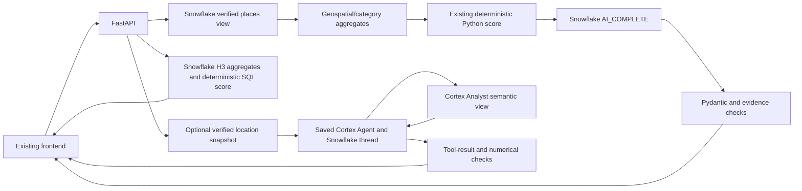

# Snowflake-native backend architecture

`SnowflakeService` retains its bound ST_DWITHIN/ST_DISTANCE query and canonical view checks. `analytics_service` and `scoring_service` remain independent of any LLM. `CortexAIService` reuses these metrics, score objects, schemas, fallback and citation policies; it sends a bound AI_COMPLETE query through the existing connector factory. Model visibility/lifecycle/region checks precede inference. The cache stores only validated successes for an hour, bounded to 128 entries per API process.

Location summaries and score explanations are optional additions to analyze, separately sourced and never model-calculated statistics. All population/survival fields are null until a verified dataset/model is genuinely integrated. Mock data and fallback sources are independent: a real remote model can process explicitly synthetic records without making them real Snowflake observations.

The working Cortex Agent SDK connection uses WAYPOINT.PUBLIC.BUSINESS_ADVISOR and its WAYPOINT.PUBLIC.BUSINESS_ANALYTICS Analyst tool. Additional saved tools are preserved. General questions do not depend on an analysis, global dashboard mock mode or a context table. The SDK creates a conversation or attaches to the actual Snowflake ID, always explicitly passing the saved data-agent specification. Snowflake stores conversation history; the API uses only in-flight locks and does not map remote IDs to process-local tokens.

Live analyses register their already-calculated metrics and marker subset in a bounded one-hour cache. The browser sends opaque references, never trusted metric values. The agent receives the current verified snapshot, while selection of an H3 zone triggers source, membership, business-category and center validation against a fresh live map query. Full-cell and circular radius metrics remain distinct, and missing demographics are null. Pre-published context lookup remains an optional compatibility path; the API no longer requires table writes. This trusted-local MVP has no tenant authentication boundary.

H3 cells originate from a fixed-resolution disk, not business presence. Geographic SQL aggregates into full cells, measures their area and mirrors the existing score formula. Empty cells are retained without scores. Heatmaps never trigger cell-by-cell inference.

Request handlers remain synchronous FastAPI worker-thread functions. Every connector cursor and connection is closed. AI statement/network timeouts are configurable; only known transient errors are retried. Agent requests are not retried automatically because turns can be persisted remotely despite timeout. Secrets remain in server settings and safe public errors never include raw connector responses. No local model server or alternative proprietary external API is invoked.
